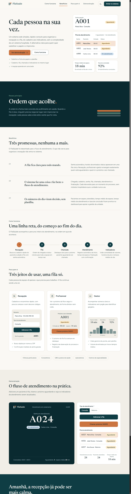
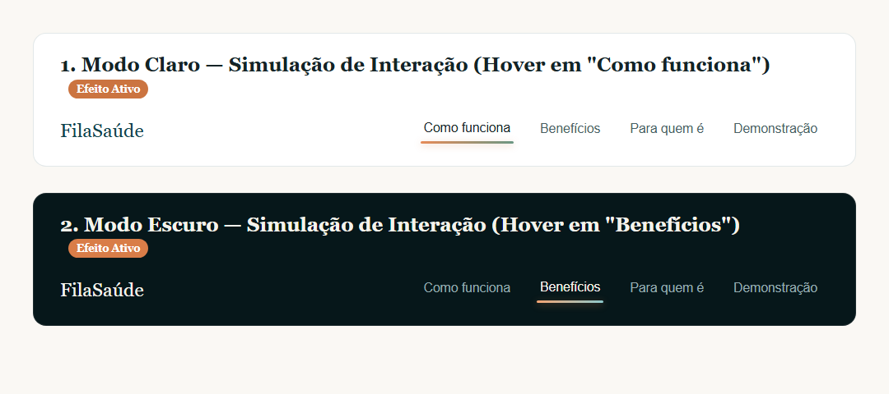
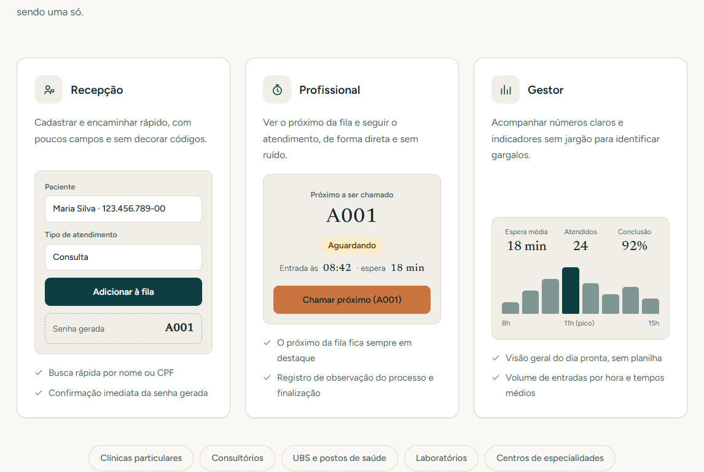
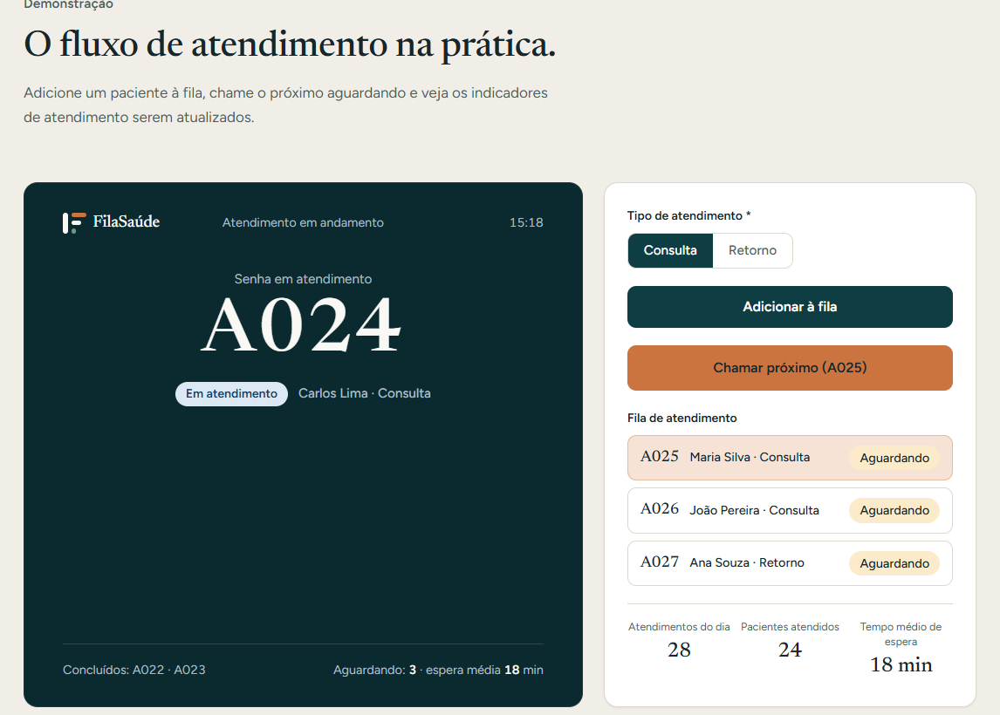
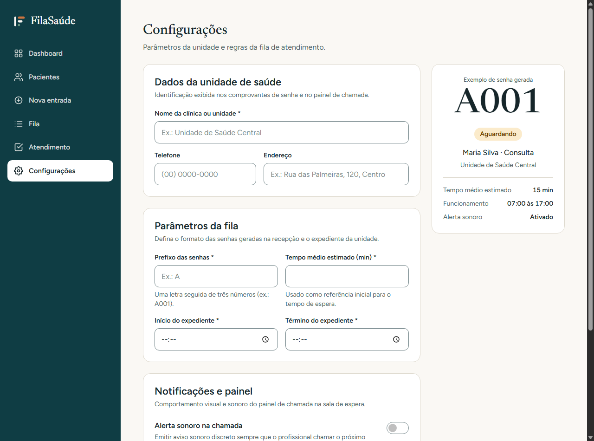
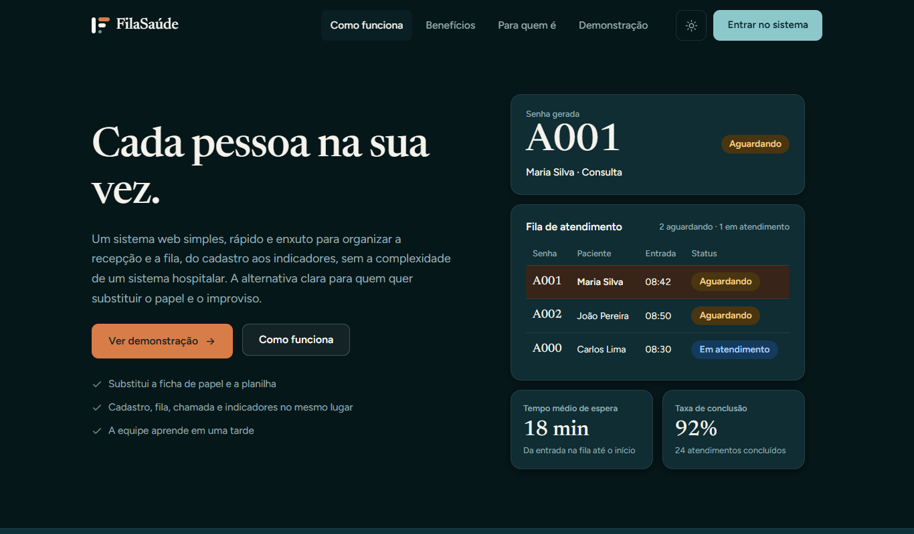

# FilaSaúde — Primeira Versão Oficial (MVP v1.0)

> **Documento Consolidado de Apresentação e Arquitetura Visual**  
> **Projeto Acadêmico:** FilaSaúde — Gestão de Atendimento em Saúde  
> **Tecnologias:** Java 21, Spring Boot 3.x, Spring MVC, Thymeleaf, Spring Data JPA, PostgreSQL, Bootstrap 5, CSS3 Moderno  
> **Arquivos Principais:** [index.html](file:///E:/filasaude/filasaude/src/main/resources/templates/index.html), [configuracoes.html](file:///E:/filasaude/filasaude/src/main/resources/templates/configuracoes.html) e [`ConfiguracaoController.java`](file:///E:/filasaude/filasaude/src/main/java/br/com/filasaude/controllers/ConfiguracaoController.java)  

---

## 1. Visão Geral: O que é o FilaSaúde?

O **FilaSaúde** é uma solução web desenvolvida para substituir o papel, a planilha e o improviso na gestão de filas de pequenas e médias unidades de saúde (clínicas, consultórios e postos de atendimento).

### Por que existe uma Landing Page antes do Login?
No modelo de software como serviço (SaaS), a página inicial não deve ser uma tela fria de login. A **Landing Page** cumpre um papel estratégico fundamental para a banca e para o usuário final:
1. **Apresentar a Proposta de Valor:** Transmite imediatamente o posicionamento acolhedor (*"Cada pessoa na sua vez."*).
2. **Explicar o Fluxo Operacional:** Demonstra como a recepção, o profissional de saúde e a gestão se conectam sem a burocracia pesada de um sistema hospitalar convencional.
3. **Demonstração Viva:** Permite que avaliadores e clientes experimentem a dinâmica da chamada de senhas direto no navegador antes mesmo de criar uma conta.

---

## 2. Visão Panorâmica da Interface

Abaixo está a renderização contínua da Landing Page em seu **Modo Claro Oficial**, priorizando sensação de papel acolhedor, leitura serena e contraste acessível:



---

## 3. Detalhamento das Seções e Recursos Implementados

### 3.1. Abertura (Hero Section) e Mockup Real do MVP
A primeira dobra da aplicação estabelece o tom visual e funcional do projeto:

* **Marca Oficial na Barra Superior:** Composta estritamente na tipografia serifada *Newsreader*, peso 500, com espaçamento entre letras de `-0.01em`, conforme as diretrizes do Manual da Marca.
* **Componente da Direita (Fila Real do MVP):** Em vez de prometer impressoras térmicas ou leitores de código de barras (fora do escopo do MVP), exibe a lista real de atendimento com a primeira paciente (`A001 · Maria Silva`) em destaque acolhedor suave (`accent-soft`), seguida de `A002 · João Pereira` com etiquetas de status oficiais (`Aguardando`).
* **Números Tabulares:** Uso de `font-variant-numeric: tabular-nums` para que senhas e horários mantenham alinhamento vertical perfeito.


---

### 3.2. Micro-interação da Barra de Navegação (Efeito Elástico)
Os links do menu superior (`Como funciona`, `Benefícios`, `Para quem é`, `Demonstração`) receberam um indicador animado de alta precisão estética:

* **Expansão a partir do Centro (*Spring Easing*):** Ao passar o cursor do mouse (`:hover`), uma barrinha em formato de pílula (3px de altura, pontas arredondadas) expande-se com física elástica suave (`transform: scaleX(0)` $\rightarrow$ `scaleX(1)` via curva `cubic-bezier(0.34, 1.56, 0.64, 1)`).
* **Gradiente da Marca e Leve Aura:** No tema claro, combina `Cobre` e `Sálvia` com sombra difusa (`rgba(203, 116, 64, 0.35)`). No tema escuro, ilumina em tons noturnos de alto contraste.
* **Acessibilidade:** Suporte total a navegação por teclado (`:focus-visible`) e respeito automático às preferências de movimento reduzido do sistema operacional.



---

### 3.3. Seção "Para quem é" (Os Três Perfis Diretos)
Apresenta de forma concisa os operadores reais da plataforma:

1. **Recepção:** Formulário ágil de entrada de pacientes sem poluição visual ou asteriscos desnecessários.
2. **Profissional:** Foco no atendimento imediato com o botão primário *"Chamar próximo (A001)"* destacado na cor `Cobre` (`#CB7440`).
3. **Gestor:** Painel analítico de distribuição horária com todas as barras padronizadas na cor `Petróleo`, respeitando o princípio de **ponto único de calor Cobre por visualização**.



---

### 3.4. Demonstração Interativa ao Vivo
Um simulador funcional na própria página que permite ao usuário interagir com o fluxo da fila sem necessidade de cadastro prévio:

* **Continuidade Numérica Realista:** Senhas sequenciais coerentes (`A022` e `A023` concluídas $\rightarrow$ `A024` ativa $\rightarrow$ `A025` a `A027` aguardando).
* **Consistência Matemática nos Indicadores:**
  $$\text{24 atendidos} + \text{1 em atendimento} + \text{3 aguardando} = \text{28 atendimentos do dia}$$
* **Desacoplamento Visual:** A marca `FilaSaúde` fica posicionada à esquerda e o indicador de serviço *"Atendimento em andamento"* no centro, com hierarquia limpa.



---

### 3.5. Tela Interna de Configurações da Unidade
Área autenticada do sistema onde o administrador gerencia as informações do estabelecimento:

* **Barra Lateral Institucional:** Padronizada com logotipo, navegação por ícones, indicador da sessão ativa (`Perfil: Gestor`) e botão de logout (`Sair`).
* **Máscara Inteligente de Telefone:** Bloqueia automaticamente letras e caracteres especiais no momento da digitação e aplica a máscara dinâmica para telefone fixo `(XX) XXXX-XXXX` ou celular `(XX) XXXXX-XXXX`, com sanitização correspondente no backend Spring Boot em [`ConfiguracaoController.java`](file:///E:/filasaude/filasaude/src/main/java/br/com/filasaude/controllers/ConfiguracaoController.java).
* **Placeholders Padronizados:** Texto de exemplo do prefixo em caixa baixa e alta suave (`Ex.: A`).



---

### 3.6. Tema Claro Nativo e Novo Sistema de Profundidade no Tema Escuro
* **Modo Claro Primário:** Todas as páginas iniciam no tema claro acolhedor por padrão (`data-theme="light"`), combinando com a atmosfera de saúde e bem-estar.
* **Tema Escuro em 4 Níveis de Relevo:** Substitui o antigo fundo plano/opaco por um sistema óptico de camadas:
  1. *Camada 0 (Canvas Noturno):* `#06171A` (Fundo base profundo).
  2. *Camada 1 (Superfícies Elevadas):* `#0F2D33` com bordas translúcidas de `1px`.
  3. *Camada 2 (Pisos e Inputs):* `#091F24` (Entradas de texto e miniaturas rebaixadas).
  4. *Camada 3 (Destaques Luminosos):* Gradientes suaves com bordas de luz nas faixas conceituais.
  5. *Ajuste Óptico do Cobre:* Calibrado para `#D97D48` no modo escuro, assegurando calor visual sem fadiga óptica.



---

## 4. Guia Rápido de Cores e Tipografia

| Nome do Token | Código Hexadecimal | Finalidade no Projeto |
| :--- | :--- | :--- |
| **Petróleo 900 / 700** | `#0C333A` / `#10434C` | Cor estrutural da marca, títulos institucionais e solidez |
| **Cobre 500 (Accent)** | `#CB7440` (Escuro: `#D97D48`) | Ponto focal único por tela (ação mais importante / chamada) |
| **Sálvia 500 (Support)** | `#6B9784` | Suporte acolhedor, elementos secundários e harmonia |
| **Névoa 50 (Fundo)** | `#FAF8F4` | Fundo quente com textura de papel de alta gramatura |
| **Newsreader** | Serifada (Google Fonts) | Logotipo FilaSaúde, títulos de destaque e números de senha |
| **Figtree** | Sem serifa (Google Fonts) | Textos de interface, formulários, botões e tabelas de leitura |

---

## 5. Como Executar e Validar o Projeto

Para rodar a aplicação localmente no ambiente de desenvolvimento:

```powershell
# Compilar e validar a integridade do código
.\mvnw.cmd compile

# Executar a suíte de testes unitários e de integração
$env:DB_PORT="5432"; $env:DB_PASSWORD="admin123"; .\mvnw.cmd test

# Iniciar o servidor Spring Boot (porta padrão: 8080)
$env:DB_PORT="5432"; $env:DB_PASSWORD="admin123"; .\mvnw.cmd spring-boot:run
```

Após iniciar, basta acessar no navegador:
* **Landing Page:** `http://localhost:8080/`
* **Painel de Configurações:** `http://localhost:8080/configuracoes`
